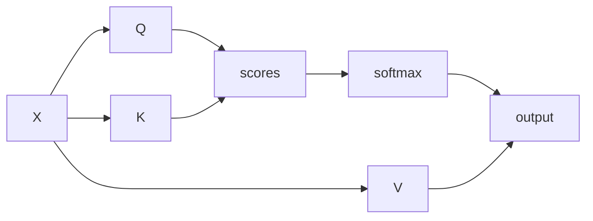

# leafdocs Markdown Generator

Produces a single `.md` file that matches what leafdocs (github.com/anshulraj10/leafdocs, 0.4.x) renders correctly, from raw notes or finished content. The rules below come from how the renderer and sanitizer actually behave, so follow them exactly. Anything outside them tends to render as plain text or get stripped.

## Frontmatter

```yaml
---
title: My Document Title
tags: [python, tutorial]
---
```

| Field   | Type                           | Fallback if omitted                         |
| ------- | ------------------------------ | ------------------------------------------- |
| `title` | string                         | Filename stem, `-` and `_` to spaces, title-cased |
| `tags`  | list, or comma-separated string | None                                        |

Both are optional in leafdocs, but always include the block. `tags: []` is fine when nothing fits.

## Workflow

1. **Get the content.**
   - Raw notes or a brain dump: write a clean, structured document in the tone the user writes in. Do not impose a different voice.
   - Finished content: keep it close to as-is. Light copyediting only, but still apply the formatting rules below, because content written for other renderers often breaks here (single-dollar math, raw HTML, `<details>`).

2. **Title.** Use the user's title verbatim if given. Otherwise infer a concise, specific one (not "Deployment", but "Leafdocs EC2 Deployment Notes").

3. **Filename and folder.**
   - The URL slug is the path without `.md`, so `guides/setup.md` is served at `/guides/setup`.
   - Slugify the title: lowercase, spaces to hyphens, strip punctuation. An explicit filename from the user wins.
   - Subfolders are supported to any depth and shown as a tree. If the user names a folder, put the file there (`guides/setup.md`). Folder names: lowercase, hyphenated. If no folder is given, do not invent one.
   - Avoid these, because they never render as docs: a top-level `login.md` or `logout.md`, anything under a top-level `static/` folder, and any folder or file name starting with `.`. `login.md` inside a subfolder is fine.
   - Do not rely on symlinks.

4. **Tags.** Infer 2 to 5 from the actual topics (lowercase, single words or short hyphenated terms). If the user names tags, use exactly those. Never pad with unrelated tags.

5. **Assemble.** Frontmatter, blank line, body. Tags as a flow list: `tags: [tag-one, tag-two]`.

6. **Self-check** against the rules below before delivering.

7. **Deliver.** Create the actual `.md` file and present it for the user to save into their own docs directory. Do not write into a specific docs directory unless the user names one.

## Formatting rules

### Structure and headings

- Start the body with one H1 matching the title, then use H2 and H3 for sections. Do not skip levels.
- A sidebar table of contents appears automatically when a doc has 3 or more headings (the H1 matching the title is not counted). Use real headings for sections so it is useful. Do not write a manual contents list.
- Line breaks inside a paragraph are kept as line breaks, so do not hard-wrap paragraphs at 80 columns. One paragraph, one line.
- Tables, lists, blockquotes and fenced code are all supported. Footnotes and task lists (`- [ ]`) are not.

### Math (KaTeX)

- Inline math: `\(...\)` only. Never use `$...$`. A single dollar sign is deliberately left alone so prices render normally, which means `$x$` shows as literal text.
- Block math: `$$...$$` or `\[...\]`, each delimiter on its own line for long formulas.
- Write TeX exactly as TeX. Do not escape underscores or backslashes. Use `\\` for row breaks in matrices and aligned blocks.
- Prices and plain dollars are fine as they are: "costs $5 and $10".
- Math works in lists, tables and admonitions. Keep formulas valid, since a bad formula shows an error only for that formula.

```markdown
The loss is \(L = -\sum_i y_i \log \hat{y}_i\), averaged over the batch:

$$
\bar{L} = \frac{1}{N} \sum_{n=1}^{N} L_n
$$
```

### Diagrams (mermaid)

- Use a fenced block labeled `mermaid`: flowchart, sequenceDiagram, classDiagram and the other standard types.
- Keep the syntax valid. A broken diagram fails on its own without affecting the page, but it still shows as an error.
- Do not put mermaid blocks inside indented containers other than a list item.

### Code

- Always label fences with a language: `python`, `bash`, `json`, `yaml`, `sql`, `js`, `diff`, and so on. Labeled fences are syntax highlighted. Unlabeled and unknown labels render as plain code, which is acceptable but less useful.
- Always close the fence. An unclosed fence renders as a paragraph of literal backticks.
- Use a longer fence (four backticks) when showing a fence inside a fence.

### Admonitions

Use for notes, warnings and tips instead of raw HTML boxes:

```markdown
!!! warning "Restart required"
    Changing `LEAFDOCS_PINS` needs a restart, which logs everyone out.
```

- Allowed types only: `note`, `tip`, `info`, `warning`, `danger`, `success`. Any other type falls back to a note.
- The title in quotes is optional. Without it the type name is the title.
- The body must be indented 4 spaces, with a blank line before and after the block. The body can hold lists, inline code and math.
- Use sparingly, a few per document at most.
- A line that starts with `!!!` is always treated as an admonition, so never begin a line with it for other reasons.

### Raw HTML

Do not write raw HTML. The renderer sanitizes it, and most tags are stripped. In particular, none of these work: `<details>`, `<summary>`, `<iframe>`, `<script>`, `<style>`, `<div class="...">`, inline `style` or `onclick`. `<details>` is stripped and leaves its text glued together. Use headings, lists and admonitions instead. Stay with plain Markdown syntax for everything.

### Links and images

- Link to another doc with a relative path: `[setup](setup.md)` or `[intro](../intro.md)`. Paths resolve relative to the current doc's folder, like files on disk. A `.md` suffix is fine, and anchors work (`other.md#heading`).
- Images: relative paths to `png`, `jpg`, `jpeg`, `gif` or `webp` files only. SVG is not served. Do not reference an image unless the user says the file exists in the docs directory, since this skill cannot create it. Mention the expected location when you do reference one.
- External links use full `https://` URLs. `javascript:` and `data:` links are stripped.

## Writing style for Anshul's docs

- No em dashes. Use commas, colons, parentheses or separate sentences.
- No hype or buzzwords. Plain, technically grounded prose, concrete specifics over generalities.
- Do not over-explain basics in ML and Python material.

## Example output

````markdown
---
title: Attention Scaling Notes
tags: [transformers, math, notes]
---

# Attention Scaling Notes

## Why divide by the square root

Scaled dot-product attention is \(\mathrm{softmax}(QK^\top / \sqrt{d_k})V\). Without the scale, logits grow with \(d_k\) and the softmax saturates.

$$
\mathrm{Var}(q \cdot k) = d_k
$$

!!! note "Assumption"
    This holds when the components of \(q\) and \(k\) are independent with zero mean and unit variance.

## Data flow



## Reference implementation

```python
def attention(q, k, v):
    scores = q @ k.transpose(-2, -1) / k.shape[-1] ** 0.5
    return scores.softmax(-1) @ v
```
````

## Edge cases

- **No clear topic to tag:** `tags: []`. Do not force tags.
- **Pasted content already has an H1:** derive `title` from it if none was given, and keep the H1 as the first heading.
- **Pasted content uses `$...$` math or HTML:** convert inline `$...$` to `\(...\)`, keep `$$...$$` blocks, and replace `<details>` or HTML callouts with admonitions or plain sections. Mention what you converted in one line.
- **Multiple distinct topics in one dump:** ask whether they want one file or several instead of guessing.
- **A feature outside these rules is requested** (task lists, footnotes, SVG images, collapsible sections): say it is not supported by leafdocs and use the closest supported option.