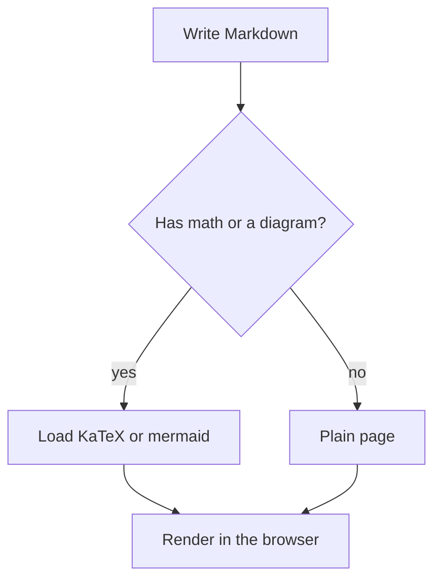

# Math and Diagrams

## Inline math

Euler's identity is \(e^{i\pi} + 1 = 0\), and a subscript with a comparison
looks like \(x_1 < x_2\). Single dollar signs are plain text, so a price
like $5 or a range like $5-$10 renders as written.

## Block math

$$
\int_0^1 x^2 \, dx = \frac{1}{3}
$$

\[
\sum_{i=1}^{n} i = \frac{n(n+1)}{2}
\]

## Flowchart

